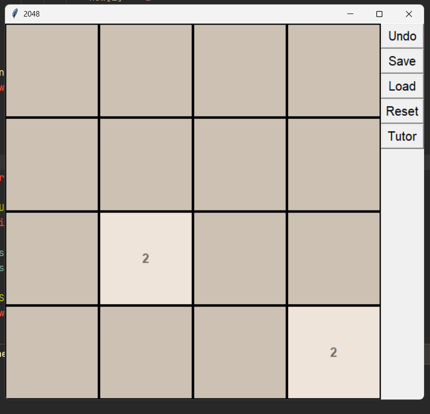

# 2048 Game

Implementasi permainan 2048 menggunakan bahasa pemrograman Python dengan library Tkinter sebagai antarmuka grafis (GUI).

## Apa Itu Game 2048?

2048 adalah permainan puzzle berbasis angka yang diciptakan pada Maret 2014 oleh pengembang web Italia, Gabriele Cirulli. Pemain diharuskan menggabungkan kotak-kotak bernomor sama dengan menggesernya ke arah tertentu hingga menghasilkan angka 2048.

Permainan ini memiliki konsep sederhana, tetapi membutuhkan strategi dalam mengatur posisi dan menggabungkan setiap kotak.

## Fitur

- Antarmuka grafis menggunakan Tkinter.
- Pergerakan kotak berdasarkan input keyboard.
- Penggabungan kotak dengan angka yang sama.
- Penambahan kotak baru setelah pergerakan yang valid.
- Sistem skor permainan.
- Kondisi Game Over ketika tidak ada pergerakan yang memungkinkan.

## Teknologi

| Teknologi | Keterangan |
|---|---|
| Python | Bahasa pemrograman |
| Tkinter | Library antarmuka grafis (GUI) |

## Persyaratan

- Python 3.x
- Tkinter

## Cara Menjalankan

1. Pastikan Python sudah terinstal.
2. Clone repository ini:

   ```bash
   git clone <URL-REPOSITORY>
   ```

3. Masuk ke direktori proyek:

   ```bash
   cd 2048-game
   ```

4. Jalankan aplikasi:

   ```bash
   python Main.py
   ```

## Kontrol Permainan

Sesuaikan bagian ini dengan input keyboard yang diimplementasikan pada aplikasi.

| Tombol | Fungsi |
|---|---|
| Arah keyboard / WASD / Arrow key | Menggeser kotak |

## Screenshot



## Referensi

- [2048 - Gabriele Cirulli](https://play2048.co/)

